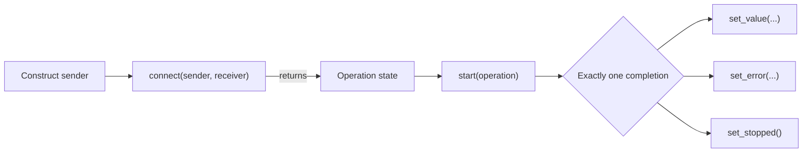
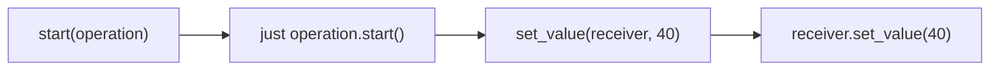
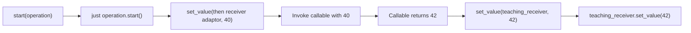

# esp-execution

`esp-execution` is a small, portable C++26 teaching component for learning the sender → receiver → operation-state
lifecycle on both the ESP-IDF Linux target and embedded targets. It is not a conforming implementation of the C++
Execution control library.

The vocabulary follows the N5054 working draft, including the current `sender_tag`, `receiver_tag`, and
`operation_state_tag` names. The complete public API can be included through the umbrella header,
`esp_execution.hpp`, and is defined in namespace `esp::execution`.

> [!WARNING]
> This implementation is incomplete. Do not treat it as a substitute for `std::execution` or
> a production execution library.

## Requirements

- ESP-IDF 6.0 or newer
- A C++26 compiler supporting `-fcontracts` and `-freflection`; the component enables these flags.

The sender/receiver vocabulary and generic adaptors are defined in headers. The ESP-IDF component also builds a
FreeRTOS task scheduling resource and depends on [`esp_freertos_cpp`](../esp_freertos_cpp/README.md) and FreeRTOS.
On non-Linux targets it also depends on [`esp_platform_cpp`](../esp_platform_cpp/README.md) and ESP-IDF system
facilities. The GPTimer scheduling resource is built when the target supports GPTimer and
`CONFIG_GPTIMER_ISR_CACHE_SAFE` is disabled.

## Header Organization

Applications can continue to include only the umbrella header:

```cpp
#include "esp_execution.hpp"
```

Generic vocabulary and adaptors are available through the umbrella header or their individual headers under
[`include/esp_execution`](include/esp_execution). Platform scheduling resources use separate headers:
[`freertos/task_context.hpp`](include/esp_execution/freertos/task_context.hpp) and
[`idf/gptimer_context.hpp`](include/esp_execution/idf/gptimer_context.hpp).

## Lifecycle

The generic process has three distinct stages:



1. Constructing a sender describes work and its possible completion signatures without running anything.
2. `connect` binds the sender to a receiver and returns an operation state. The operation state owns everything required
   to execute the operation independently of the original sender and receiver objects.
3. `start` begins the operation and may be called at most once. Once started, exactly one of `set_value`, `set_error`,
   or `set_stopped` completes it. After that completion executes, the operation state is invalid and must not be
   accessed or started again.

For `just(40)`, sender construction stores `40`, and connection transfers it together with the receiver into the
operation state. Starting that operation delivers the stored value directly to the receiver:



Adding `then` changes the receiver connected to `just`. It does not create an additional operation-state layer. During
connection, `then` wraps the final receiver with its callable and connects that adapted receiver to `just`:

```cpp
using namespace esp::execution;

auto work = just(40) | then([](int value) noexcept { return value + 2; });
auto operation = connect(std::move(work), teaching_receiver{&result});
start(operation);
```

When the operation is started, the complete synchronous call chain is:



The `just`, `just_error`, and `just_stopped` factories complete synchronously on the thread or FreeRTOS task that calls
`start`. `then` invokes its callable inline on whichever execution context delivers the upstream value completion.
Scheduling senders can complete asynchronously on a worker task or in an ISR.

Operation states supplied by this component are immovable and noncopyable. Completion functions and `start` are required
to be `noexcept`.

A `freertos::task_context` owns a worker and bounded queue. Its scheduler and started operations borrow the context;
keep both the context and each operation alive through completion. Accepted work completes on the worker; queue
rejection completes on the submitting context, which can be an ISR. Stop producers and wait for submissions to return
before `finish()` or destruction. Consult the [task context header](include/esp_execution/freertos/task_context.hpp)
for admission policies and lifecycle restrictions.

An `idf::gptimer_context` owns a continuously running timer and accepts one outstanding deadline. Successful completion
runs in the timer ISR; errors run where detected. Receivers must be safe in those contexts. Use `continues_on` to hand
work to a task, and keep the context and operation alive until completion. Stop producers and complete the pending
operation before destroying the context. See the [timer context header](include/esp_execution/idf/gptimer_context.hpp).

The [basic example](examples/basic) demonstrates an explicit receiver. The
[GPTimer blink](examples/gptimer_blink) and [ping-pong](examples/gptimer_ping_pong) examples demonstrate timer-to-task
handoffs.

## References

- [N5054 working draft snapshot](https://www.open-std.org/jtc1/sc22/wg21/docs/papers/2026/n5054.pdf)
- [Evolving Execution chapter](https://eel.is/c++draft/exec)
- [Evolving sender concepts](https://eel.is/c++draft/exec.snd.concepts)
