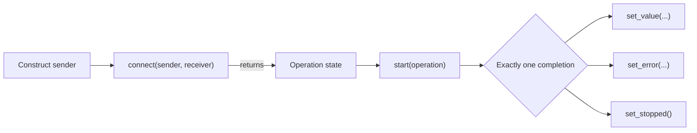
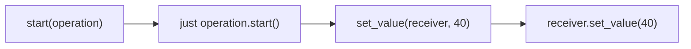
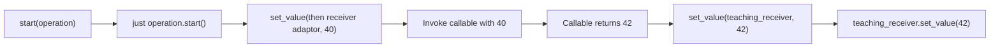

# esp-execution

<!--toc:start-->

- [esp-execution](#esp-execution)
  - [Requirements](#requirements)
  - [Header organization](#header-organization)
  - [Lifecycle](#lifecycle)
  - [Example](#example)
  - [Deliberate deviations from N5054](#deliberate-deviations-from-n5054)
  - [Validation](#validation)
  - [References](#references)

<!--toc:end-->

`esp-execution` is a small, portable C++26 teaching component for learning the sender → receiver → operation-state
lifecycle on both the ESP-IDF Linux target and embedded targets. It is not a conforming implementation of the C++
Execution control library.

The vocabulary follows the N5054 working draft, including the current `sender_tag`, `receiver_tag`, and
`operation_state_tag` names. The complete public API can be included through the umbrella header,
`esp_execution.hpp`, and is defined in namespace `esp::execution`.

> [!WARNING]
> This component is pedagogical and intentionally incomplete. Do not treat it as a substitute for `std::execution` or
> a production execution library.

## Requirements

- ESP-IDF 6.0 or newer
- A C++26-capable compiler (bundled with ESP-IDF)

The component is header-only and has no ESP-IDF runtime dependency.

## Header Organization

Applications can continue to include only the umbrella header:

```cpp
#include "esp_execution.hpp"
```

The implementation is split into topic headers in the same order in which the execution model is introduced:

- `concepts.hpp` collects the receiver, operation-state, sender, and `sender_in` concepts together with their tags and
  internal member-dispatch constraints.
- `environment.hpp` defines `empty_env`, `get_env`, and `env_of_t` using the named member-query constraint.
- `completion.hpp` defines completion signatures and the three constrained completion operations.
- `operation_state.hpp` defines `start`.
- `connect.hpp` defines `connect` and its internal compatibility machinery.
- `sender_adaptor.hpp` defines the reusable `sender_adaptor_closure` base, `std::bind_back`-based adaptor storage, and
  sender pipe syntax.
- `just.hpp` defines the immediate value, error, and stopped factories.
- `then.hpp` defines value transformation and partial application.

Each topic header includes its own prerequisites and can be included directly. The umbrella header lists them explicitly
in this teaching order, so it also serves as a compact map of the component.

## Lifecycle

The generic process has three distinct stages:



1. Constructing a sender describes work and its possible completion signatures without running anything.
2. `connect` binds the sender to a receiver and returns an operation state. The operation state owns everything required
   to execute the operation independently of the original sender and receiver objects.
3. `start` begins the operation and may be called at most once. Once started, exactly one of `set_value`, `set_error`,
   or `set_stopped` completes it. After that completion executes, the operation state is invalid and must not be
   accessed or started again.

For `just(40)`, sender construction stores `40`, and connection transfers it together with the receiver into the
operation state. Starting that operation delivers the stored value directly to the receiver:



Adding `then` changes the receiver connected to `just`. It does not create an additional operation-state layer. During
connection, `then` wraps the final receiver with its callable and connects that adapted receiver to `just`:

```cpp
using namespace esp::execution;

auto work = just(40) | then([](int value) noexcept { return value + 2; });
auto operation = connect(std::move(work), teaching_receiver{&result});
start(operation);
```

When the operation is started, the complete synchronous call chain is:



The `just`, `just_error`, and `just_stopped` factories complete synchronously on the thread or FreeRTOS task that calls
`start`. `then` invokes its callable inline on whichever execution context delivers the upstream value completion. With
the senders supplied by this component, that is the context that called `start`; future asynchronous senders may
complete elsewhere.

Operation states supplied by this component are immovable and noncopyable. Completion functions and `start` are required
to be `noexcept`.

The complete minimal-build ESP-IDF example is under [examples/basic](examples/basic). Its explicit receiver keeps all
three completion channels visible.
## References

- [N5054 working draft snapshot](https://www.open-std.org/jtc1/sc22/wg21/docs/papers/2026/n5054.pdf)
- [Evolving Execution chapter](https://eel.is/c++draft/exec)
- [Evolving sender concepts](https://eel.is/c++draft/exec.snd.concepts)
